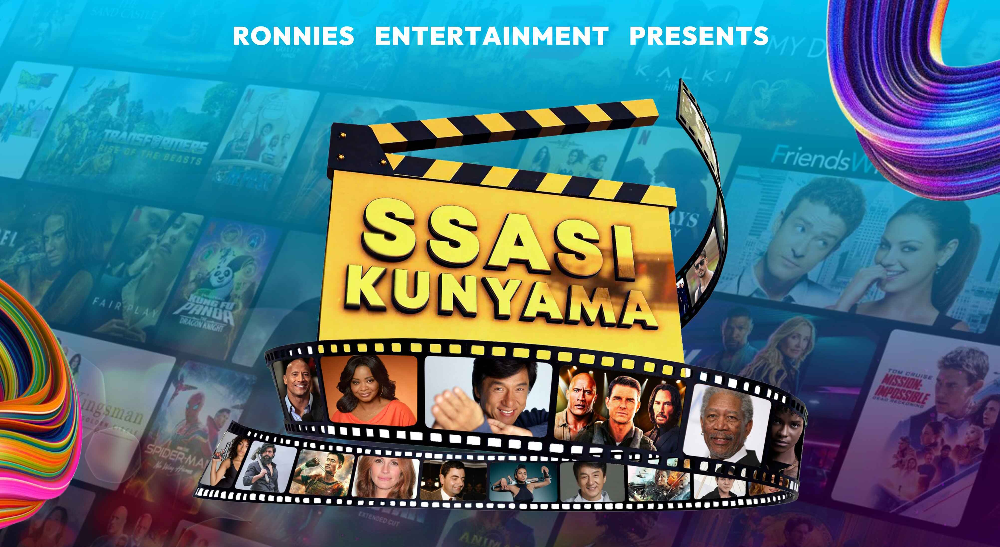
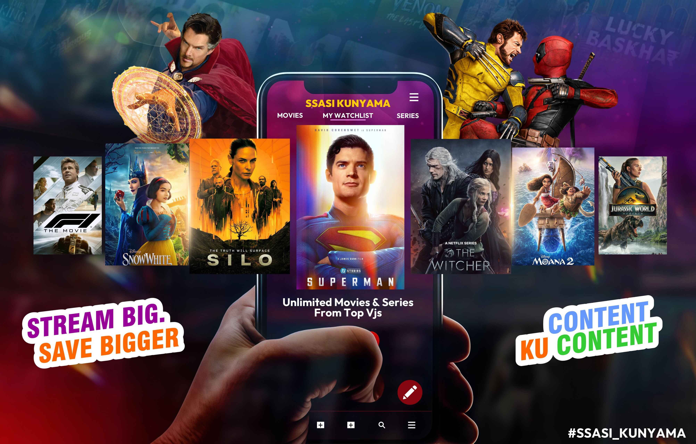

<h1 align="center"> Ssasikunyama Movies </h1> <br>
<p align="center">
  <a href="https://ssasikunyama.com/">
    
  </a>
</p>

<p align="center">
  Professional movie streaming platform for English & Ugandan local movies. Built with React & TypeScript.
</p>

<p align="center">
  <a href="https://ddumba.kyakabi.com">
    
  </a>

  <a href="https://kyakabi.com">
    
  </a>
</p>

<!-- START doctoc generated TOC please keep comment here to allow auto update -->
<!-- DON'T EDIT THIS SECTION, INSTEAD RE-RUN doctoc TO UPDATE -->
## Table of Contents

- [Introduction](#introduction)
- [Features](#features)
- [Project Background](#project-background)
- [Technology Stack](#technology-stack)
- [Installation](#installation)
- [Development](#development)
- [Contributing](#contributing)
- [Developer](#developer)
- [Company](#company)
- [License](#license)

<!-- END doctoc generated TOC please keep comment here to allow auto update -->

## Introduction

[](https://reactjs.org/)
[](https://www.typescriptlang.org/)
[](https://vitejs.dev/)
[](https://nodejs.org/)
[](LICENSE)
[](http://makeapullrequest.com)

**Ssasikunyama Movies** is a professional movie streaming platform developed for **Ronnie's Entertainment**, a leading movie distributor in Uganda. The platform provides seamless access to thousands of English and local Ugandan (Kinauganda) movies with a modern, user-friendly interface and robust subscription management system.

**Built with cutting-edge technology by Ddumba Abdallah Kato.**

<p align="center">
  
</p>

## Features

A comprehensive set of features designed for modern movie streaming:

* **Movie Streaming & Downloads**: High-quality streaming with download capabilities
* **User Authentication**: Secure login/register system with role-based access
* **Subscription Management**: Flexible plans starting from UGX 5,000
* **Admin Dashboard**: Complete content and user management system
* **Movie Categories**: Organized by English and local Ugandan content
* **Trending Movies**: Real-time popular content tracking
* **Payment Integration**: Secure payment processing
* **Responsive Design**: Optimized for all devices
* **Real-time Notifications**: User activity and system updates

<p align="center">
  
</p>

<p align="center">
  
</p>

## Project Background

This project was commissioned by **Ronnie Ssentongo**, a prominent movie distributor in Uganda, to address the growing demand for digital movie distribution in the East African market. The platform serves as a bridge between traditional movie distribution and modern digital streaming, specifically catering to:

- **Local Content Preservation**: Providing a dedicated platform for Ugandan movies
- **Accessibility**: Making movies accessible across various devices and locations
- **Revenue Generation**: Creating sustainable monetization through subscriptions
- **Content Management**: Streamlining movie distribution and updates

The project represents a significant step in digital transformation for the entertainment industry in Uganda, combining local content with global technology standards.

## Technology Stack

### Frontend
- **React 18** with TypeScript for type-safe development
- **Vite** for lightning-fast development and builds
- **Tailwind CSS** for utility-first styling
- **shadcn/ui** for beautiful, accessible components
- **React Router** for seamless navigation
- **TanStack Query** for server state management

### Backend
- **Node.js** with Express.js framework
- **SQLite/PostgreSQL** for robust data storage
- **RESTful API** architecture
- **JWT Authentication** for secure access
- **File Upload System** for movie content management

### Deployment & DevOps
- **Vercel/Render** for hosting
- **GitHub Actions** for CI/CD
- **Environment-based configuration**

## Installation

Get started with development in minutes:

```bash
# Clone the repository
git clone https://github.com/Hatalabdallah/ssasikunyama-movies.git

# Navigate to project directory
cd ssasikunyama-movies

# Install dependencies
npm install

# Start development server
npm run dev
```

The application will be available at `http://localhost:8080`

## Development

### Build Commands
```bash
# Development build
npm run dev

# Production build
npm run build

# Preview production build
npm run preview

# Linting
npm run lint
```

### Environment Setup
Create a `.env` file in the root directory:
```env
VITE_API_URL=your_api_url
VITE_MAINTENANCE_MODE=false
```

## Contributing

We welcome contributions! Please feel free to submit PRs for any issues or feature requests. Check out our [Contributing Guidelines](CONTRIBUTING.md) for detailed information.

### Code of Conduct
Please read our [Code of Conduct](CODE_OF_CONDUCT.md) before contributing.

## Developer

**Ddumba Abdallah Kato**  
*Full Stack Developer & Technical Lead*

- 🌐 **Portfolio**: [ddumba.kyakabi.com](https://ddumba.kyakabi.com)
- 📧 **Email**: [a.ddumba@kyakabi.com](mailto:a.ddumba@kyakabi.com)
- 📱 **Phone**: [+256701019242](tel:+256701019242)
- 💼 **LinkedIn**: [Ddumba Abdallah Kato](https://linkedin.com/in/ddumba-abdallah)
- 🐦 **Twitter**: [@ddumba_abdallah](https://twitter.com/ddumba_abdallah)

## Company

**Kyakabi Group Limited**  
*End-to-End Software Solutions*

🌐 **Website**: [https://kyakabi.com](https://kyakabi.com)

We specialize in:
- Custom Software Development
- Web & Mobile Applications
- ERP Systems
- E-commerce Solutions
- Corporate IT Training
- Digital Transformation

## License

Copyright © 2017-2025 Kyakabi Group Limited. All rights reserved.

See the [LICENSE](LICENSE) file for detailed information.

---

*Crafted with excellence by Ddumba Abdallah Kato - Transforming entertainment through technology.*

## Image Mapping Used:
- **Main logo**: `./public/sassi/SSASI.jpg` (your main branding image)
- **Movie interface**: `./public/sassi/content.jpg` (shows movie content)
- **Platform front**: `./public/sassi/KUNYAMA-FRONT.jpg` (front view of platform)
- **Platform back**: `./public/sassi/KUNYAMA-BACK.jpg` (back view/technical side)

## To Add Actual Screenshots Later:
1. Run your application: `npm run dev`
2. Take screenshots of:
   - Homepage with movie slider
   - Admin dashboard
   - Mobile responsive view
3. Save them in a `docs/screenshots/` folder
4. Update the image paths to use your actual screenshots

The images from your `public/sassi/` directory will now display properly in GitHub!